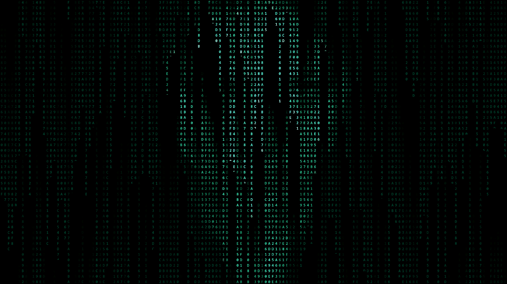
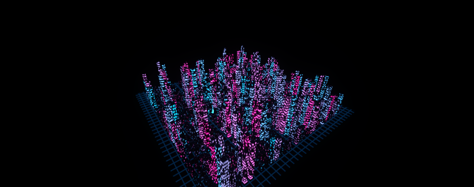
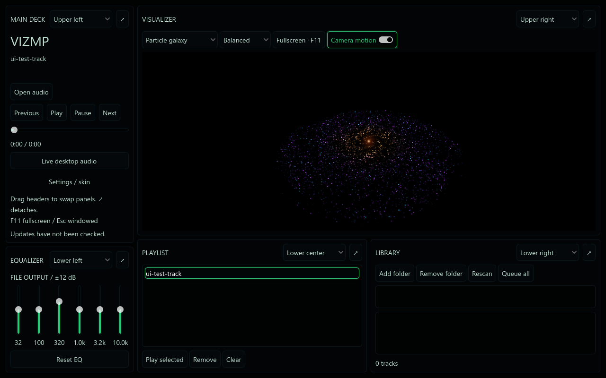

# VizMP

**Give your music something to look at.**

VizMP is a Windows music player and live audio visualizer with a love for neon,
particle galaxies and glowing CRTs. Play your own music, react to the sound
already playing on your desktop, or let a visualizer take over the screen.

**[Download for Windows](https://github.com/ItsBugMan/VizMP/releases/latest)**
 · [View releases](https://github.com/ItsBugMan/VizMP/releases)
 · [Report an issue](https://github.com/ItsBugMan/VizMP/issues)

## New in 1.1.0

**[Reactive Expansion release notes](https://github.com/ItsBugMan/VizMP/releases/tag/v1.1.0)**

Lightning Storm and ASCII Face Rain join the collection, alongside eight new
retro skins. This update fixes audio reactivity lost when the equalizer changed
the audio chain, steadies the fractal camera and geometry, and adds a 0–8×
sensitivity control. The player now opens with the visualizer hidden to give
the deck more room; restore it in **Visualizer settings…** or press **F11**.

## Pick your view

Switch between seven visualizers, each with its own way of responding to your audio:

- **Radial Spectrum** — a circular spectrum that puts the shape of your music front and center.
- **Particle Galaxy** — a swirling 3D galaxy of particles with audio-driven motion and bursts.
- **Fractal Tunnel** — fly through a twisting, colorful tunnel of repeating geometry.
- **Spectrum City** — a neon skyline that rises and pulses with the music.
- **Vector CRT Scope** — watch left and right audio channels draw glowing X-Y patterns, with green or amber phosphor and lingering trails.
- **Lightning Storm** — bass-triggered branching lightning lights layered storm clouds with HDR flashes and lingering afterglow.
- **ASCII Face Rain** — falling green character lights reveal an original portrait; silence leaves every visualizer pixel black.

Choose **Low**, **Balanced** or **High** quality, toggle camera motion in supported
modes, and press **F11** when you want the visuals to fill the screen.
The visualizer starts minimized. Open **Settings / skin → Visualizer settings…**
and check **Enable Visualizer Viewport** to restore it. This modal also includes
an audio sensitivity slider (0–8×). F11 opens the visualizer directly; Esc returns
to the previous deck state. Hidden visualizers suspend rendering and processing.
See [reactive expansion implementation and validation](docs/REACTIVE_EXPANSION.md)
for scene structure, shader budgets, skin authoring, and known limitations.

*Actual VizMP captures using generated test audio and spectrum inputs.*

## Your music, your way

- **Play FLAC, MP3, OGG Vorbis and WAV.** Open files or drop them straight into the player, including native lossless FLAC playback.
- **Visualize desktop audio.** Enable **Live desktop audio** to react to music, browser audio or games playing through your default Windows output device.
- **Build a local library.** Add music folders, scan their subfolders, double-click a track to play it, or queue the whole library.
- **Keep playback within reach.** Previous, play, pause, next, elapsed time and a seek bar are built in.
- **Set your listening level.** File volume and mute live in the transport panel, with a percentage display and automatically saved preferences.
- **See what's playing.** Track titles, artists, albums and embedded artwork appear where the file's metadata is supported.
- **Shape file playback.** A six-band equalizer lets you adjust the sound from bass to treble.

FLAC playback works throughout the player, library and screensaver. FLAC tags
and embedded artwork are not yet read, so those tracks display their filenames.

## Make it your listening space

Move the player, equalizer, visualizer, playlist and library into the arrangement
that suits you. Resize panels, swap their positions or detach them into separate
windows. VizMP remembers your layout.

The original six skins are **Classic Mint**, **Midnight Violet**,
**Amber Terminal**, **Cyberpunk**, **Brushed Metal** and **Retro Phosphor**.
The eight retro expansion packages are **Y2K Chrome**, **Neon Ronin** (anime),
**V12 Redline** (cars), **Arsenal Titanium** (guns), **Velvet Muse** (women),
**Orbital EVA** (astronauts), **Sentinel Head** (robots), and **Xeno Pod**.
They add original vector artwork, brushed or moulded surface shaders, shaped
panel frames, transport glyphs, and LCD readouts across floating sub-windows.
That brings the collection to **14 skins**. Custom JSON and texture-atlas skins
are supported too.

## Let it run as your screensaver

VizMP also includes a Windows screensaver. Choose your visualizer, quality and
skin, then use live desktop audio or a shuffled playlist from a music folder.

The installer offers optional screensaver registration. You can adjust its
preferences from **Settings / skin → Screensaver settings…** inside VizMP.
See the [screensaver guide](docs/WINDOWS_SCREENSAVER.md) for configuration and
current Windows preview limitations.

## Start listening

1. Open the **[latest release](https://github.com/ItsBugMan/VizMP/releases/latest)**.
2. Choose the **installer** for setup and shortcuts, or the **portable ZIP** to run from a folder. Extract the complete ZIP and keep its DLL and helper folders together.
3. Launch **VizMP.exe**. Choose **Open audio**, drop in a track, or start audio in another app and enable **Live desktop audio**.
4. Open **Settings / skin → Visualizer settings…**, check **Enable Visualizer Viewport**, then pick a mode and skin. Press **F11** for fullscreen.

**F11** toggles fullscreen. **Escape** or a left click returns from visualizer
fullscreen. Use **↗** on a panel to detach it, and **Settings / skin → Reset panel
layout** to return to the default arrangement.

**Windows x64 · DirectX 12-capable graphics · No separate Godot or .NET installation required.**
The current Windows build uses Godot 4.7.2 with Forward+ rendering. Lower the
quality preset if you need a lighter visualizer. Desktop capture follows your
Windows default output device; see the [audio guide](docs/DESKTOP_LOOPBACK.md)
if another app is routed to a different device.

Check for new versions from **Settings / skin → Check for updates…**. VizMP
asks before downloading and installing an update.

The existing file oscilloscope can show an empty trace on 7.1 output devices;
use a stereo output device for that mode. The FFT-based visualizers, including
the new modes, work with the tested 7.1 endpoint. Lightning uses a layered
procedural cloud approximation. See the [implementation notes](docs/REACTIVE_EXPANSION.md)
for measured performance and remaining limitations.

## Credits

Created by **[ItsBugMan](https://github.com/ItsBugMan)**, with development assistance from OpenAI Codex.
The ASCII mode includes an original fictional portrait generated with OpenAI's
image generation tool. The expansion skin artwork is original editable vector art.

VizMP is built with the work of these projects and their contributors:

- **[Godot Engine](https://godotengine.org/)** — the application, audio engine and visual rendering.
- **[godot-xiph-audio](https://github.com/goatchurchprime/godot-xiph-audio)** by **Julian Todd / goatchurchprime** — native FLAC audio support.
- **[NAudio](https://github.com/naudio/NAudio)** by **Mark Heath and contributors** — the WASAPI audio library used by VizMP's desktop capture helper.
- **Xiph.Org codecs and godot-cpp** — codec and native extension dependencies; see the [Xiph third-party notices](addons/xiph_audio/THIRD_PARTY_NOTICES.md).
- **[.NET](https://github.com/dotnet/runtime)** — the runtime bundled with the Windows audio capture helper.
- **[Inno Setup](https://jrsoftware.org/)** — Windows installer packaging.

Third-party components retain their own licenses. The Windows downloads include
the Xiph extension notices and the capture helper's NAudio and .NET notices.

## For builders and curious listeners

Want to make your own skin, tune a visualizer or explore how the audio drives
it? The implementation guides live in [`docs/`](docs/):

- [Custom skins and panel layout](docs/MODULAR_UI_SKINS.md)
- [Reactive expansion: lightning, ASCII rain, sensitivity and retro skins](docs/REACTIVE_EXPANSION.md)
- [Library, artwork, transport and graphics](docs/FIDELITY_AND_LIBRARY.md)
- [Volume, mute and saved audio preferences](docs/VOLUME_CONTROL.md)
- [Desktop audio capture](docs/DESKTOP_LOOPBACK.md)
- [FLAC extension setup](docs/FLAC_WINDOWS.md)
- [Particle Galaxy](docs/PARTICLE_GALAXY.md) · [Fractal Tunnel and Spectrum City](docs/TUNNEL_AND_CITY.md)
- [Vector CRT Scope and capture validation](docs/OSCILLOSCOPE.md)
- [Windows builds, installer and updates](docs/DISTRIBUTION_AND_UPDATES.md)
- [Audio architecture](docs/ARCHITECTURE.md)

To run from source, open `project.godot` in **Godot 4.7.2** and press **F5**.
File playback includes the Xiph extension in `addons/xiph_audio/`. Desktop
capture also requires building the included [Windows helper](docs/DESKTOP_LOOPBACK.md).

Found a bug or have a visualizer idea? **[Open an issue](https://github.com/ItsBugMan/VizMP/issues)**.
If VizMP earns a place on your desktop, a GitHub star helps others find it.
